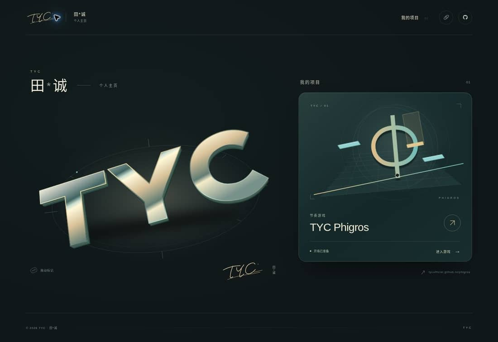

# TYC · 田*诚

TYC 的个人主页，以及 TYC Phigros 的直接入口。



## 这一版

- 移除旧版英文口号与大段介绍，保留田*诚、TYC、个人主页及实际项目。
- TYC 立体标记、手写签名、节奏图形均为自行绘制的 SVG / CSS；主页不导入字体，不使用 AI 位图、Canvas 软件光栅化或 WebGL 渲染循环。
- 标记支持拖动与方向键；Home 复位。动效按钮与系统减少动态设置有效。
- 手机竖屏、横屏与桌面分别排版，安全区由 CSS 处理。没有读取尺寸后再反复写回 Canvas 宽高的反馈路径。

## 进入项目

点击项目卡片，已预载的真实开场从卡片位置等比放大，然后浏览器真正导航到 `https://tycofficial.github.io/phigros/`。没有主页内游戏工作区、额外打开按钮或 `#project=` 游戏模式。旧书签会转成真实导航；浏览器返回时清理转场状态。

主项目的 iframe 在 HTML 解析时就开始加载，模块初始化时接管已有节点。它只用作短暂的视觉衔接，不接收游戏输入。普通首访使用规范 URL，允许复用缓存；仅检测到服务端版本改变时使用稳定的版本标识，不再每次生成随机地址。后台继续检查首页更新。

点击不会等待整个游戏脚本包下载完成。预载尚未完成、动画不可用或系统减少动态时，也会直接进入目标网站。修饰键、长按和无 JavaScript 环境保留原生链接。

跨站导航仍由浏览器负责，不能把 iframe 已运行的 JavaScript 上下文直接变成另一域名的顶层页面。因此不承诺跨浏览器绝对零网络等待；本页会提前准备开场与资源，并保持目标地址是真实网站。

## 构建与部署

无需安装依赖，Node.js 20+：

```sh
npm run check
npm test
npm run build
```

`dist/` 是完整静态输出。GitHub Actions 自动检查、测试并发布，所有本地资源使用相对路径，兼容 `/homepage/`。PWA 缓存只作用于主页；游戏站点管理自己的资源。

新增项目使用 `data-project="标识"`、`data-project-title="名称"` 和真实 `href`，可选 `data-project-status` 就绪提示。预载目标需允许嵌入，导航本身不受此限制。

## 验证范围

25 项测试覆盖真实目标导航、冷预载不阻塞点击、修饰键、转场取消、首次迟到的 pageshow、返回恢复、缓存地址稳定、后台替换、队列和图形尺寸安全。Chrome 实测包含真实站点跳转、返回、390×844 / 844×390 及高像素密度下连续 20 次切换；无横向溢出、Canvas 或页面脚本错误。未直接运行 iOS Safari 实机测试。
