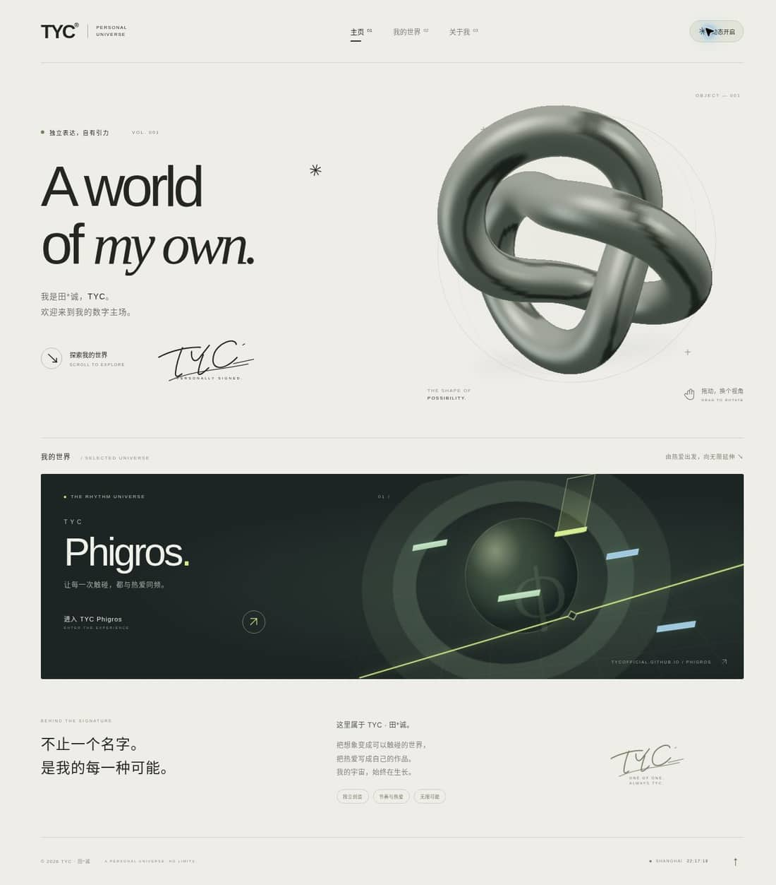
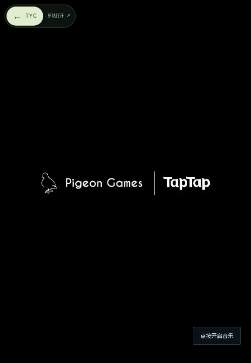

# TYC — A world of my own.

田*诚的个人数字主场。雾白展厅、实时金属 3D 纽结、手写 TYC 签名，以及直接展开 [TYC Phigros](https://tycofficial.github.io/phigros/) 真实预载首页的放大转场。



## 使用

无需安装依赖。部署整个目录，或使用 Node.js 20+：

```sh
npm run check
npm test
npm run build
```

`dist/` 是完整静态网站，可部署到 GitHub Pages。所有资源使用相对路径，兼容 `/homepage/` 子目录。不要直接通过 `file://` 打开 ES modules；本地预览请使用 HTTP 静态服务。

## GitHub Pages

仓库包含 `.github/workflows/pages.yml`。在仓库 **Settings → Pages → Build and deployment → Source** 选择 **GitHub Actions**，再运行 **Check and deploy TYC Home** 工作流。`main` 的后续提交会自动检查、测试和部署。

## 交互

- 3D 雕塑支持鼠标拖动、触摸横向拖动、方向键旋转和 Home 复位。纵向手势保留页面滚动。
- 打开主页即开始预载所有已声明项目的真实首页，同时最多准备两个。入口标明实际就绪状态；尚未就绪时保持主页可见，不用装饰页假装已进入。
- 普通点击直接把同一个已加载的项目窗口放大到全屏，保留其浏览上下文；不移动 iframe、不重新设置 src、不在动画后跳转并重新加载。页面以等比缩放配合卡片裁切展开，避免拉伸游戏。
- TYC Phigros 保留真实链接；修饰键点击、长按和新标签页保持原生行为。全屏项目左上角可返回 TYC，或用“原站打开”进入独立网站。
- 顶部按钮可关闭动态并保存偏好；系统“减少动态效果”优先。无 WebGL 时使用 Canvas 3D 后备渲染，无 JavaScript 时链接仍可用。
- 支持浏览器前进、后退和 `#project=phigros` 路由；游玩期间暂停主页 3D 与时钟。返回后销毁已使用的项目上下文以停止声音，再自动准备它的新首页。
- 支持 PWA 安装与缓存后的首页离线访问。iOS 用 Safari 的“分享 → 添加到主屏幕”。Phigros 是独立网站，需要它自身的网络与离线支持。

## 自动更新与新增项目

主页可见且没有打开项目时，每 60 秒用不缓存的 HEAD 请求检查首页 ETag / Last-Modified；回到前台、恢复网络时也检查。发现变化后在后台准备新版，完整加载后才替换旧预载；正在打开或游玩的页面不会被更新打断。没有开放跨域校验头的项目，使用五分钟的空闲刷新后备策略。每次主页新打开或关闭项目后重新准备首页时，入口请求携带独立缓存标识。

项目卡片声明以下属性即可自动接入；运行时新增卡片也会被发现：

```html
<a data-project="my-project" data-project-title="项目名称" href="https://example.com/">
  进入项目 <span data-project-status role="status">首页预载中…</span>
</a>
```

项目地址需支持被 iframe 嵌入。父页面遵守跨域策略，不读取或复制项目 DOM，不预先申请音频自动播放；用户进入后点击游戏仍可开启声音。独立原站与嵌入页面的储存可受浏览器分区策略影响，需要原站环境时使用“原站打开”。首次打开主页时，网络请求尚未完成仍需等待；“无需二次加载”指已经就绪的首页，歌曲、谱面等后续资源由项目自身按需加载。

## 验证

`npm test` 包含 20 项测试，覆盖多项目队列、使用原预载文档、后台版本替换、更新中进入、游玩中不刷新、失败重试、释放、原生链接、减少动态、历史记录与快速前进后退。浏览器实测 Phigros 展开前后 iframe 的加载计数均为 1；点击后的音频可正常播放。另用真实 HTTP 测试页验证后台内容由版本一换到版本二，以及动态新增项目自动预载。当前浏览器实测为 Chrome，未直接运行 iOS Safari。



## 文件

`sculpture.js` / `geometry.js`：原生 WebGL 网格、金属环境光、交互与恢复。`project-preloader.js`：真实项目窗口队列、版本检查与替换。`project-app.js`：项目发现、就绪状态、前后台调度。`navigation.js`：展开与返回动画、历史记录。`sw.js`：仅作用于本首页目录的缓存。更新缓存结构时增加 `CACHE` 版本。

主页无需第三方 JavaScript、外部字体、追踪器或第三方 API；只加载声明的项目及其资源，检查其首页响应头。主页不会收集访问者个人资料，项目页面遵循各自的数据行为。
